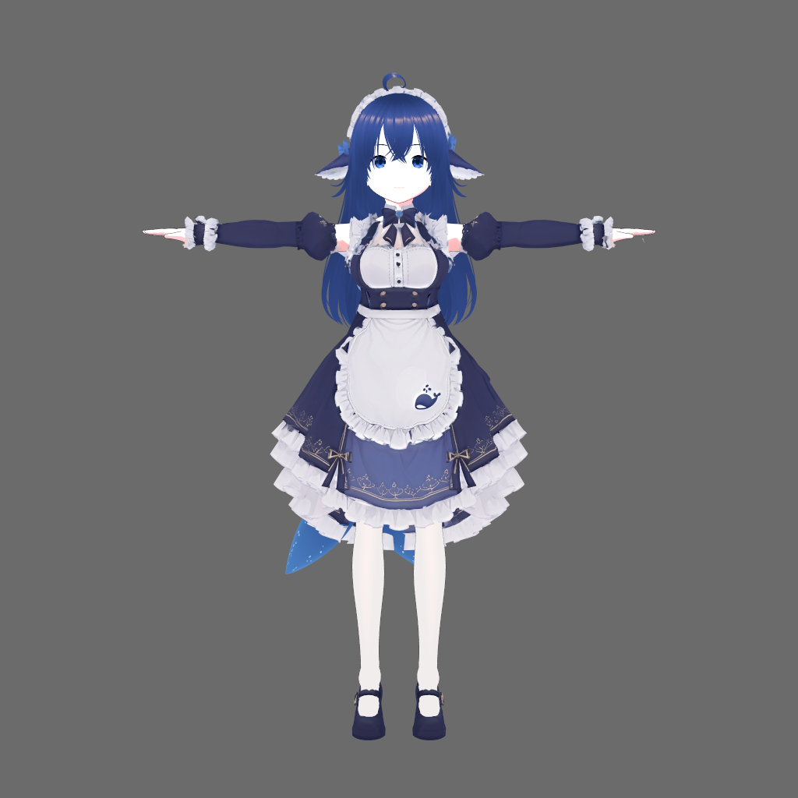
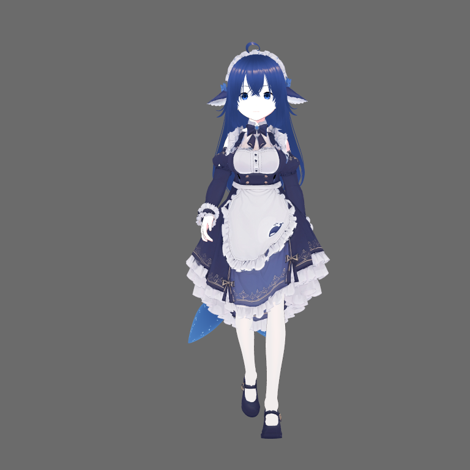
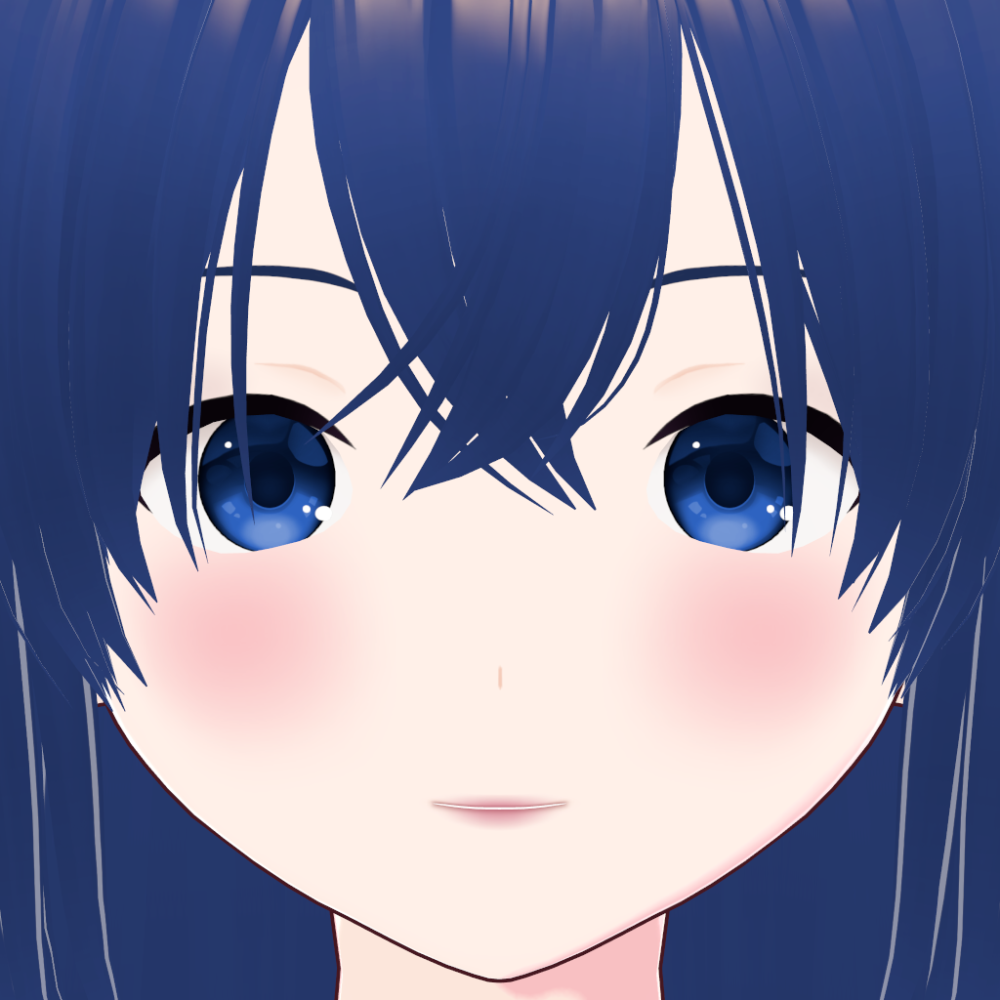
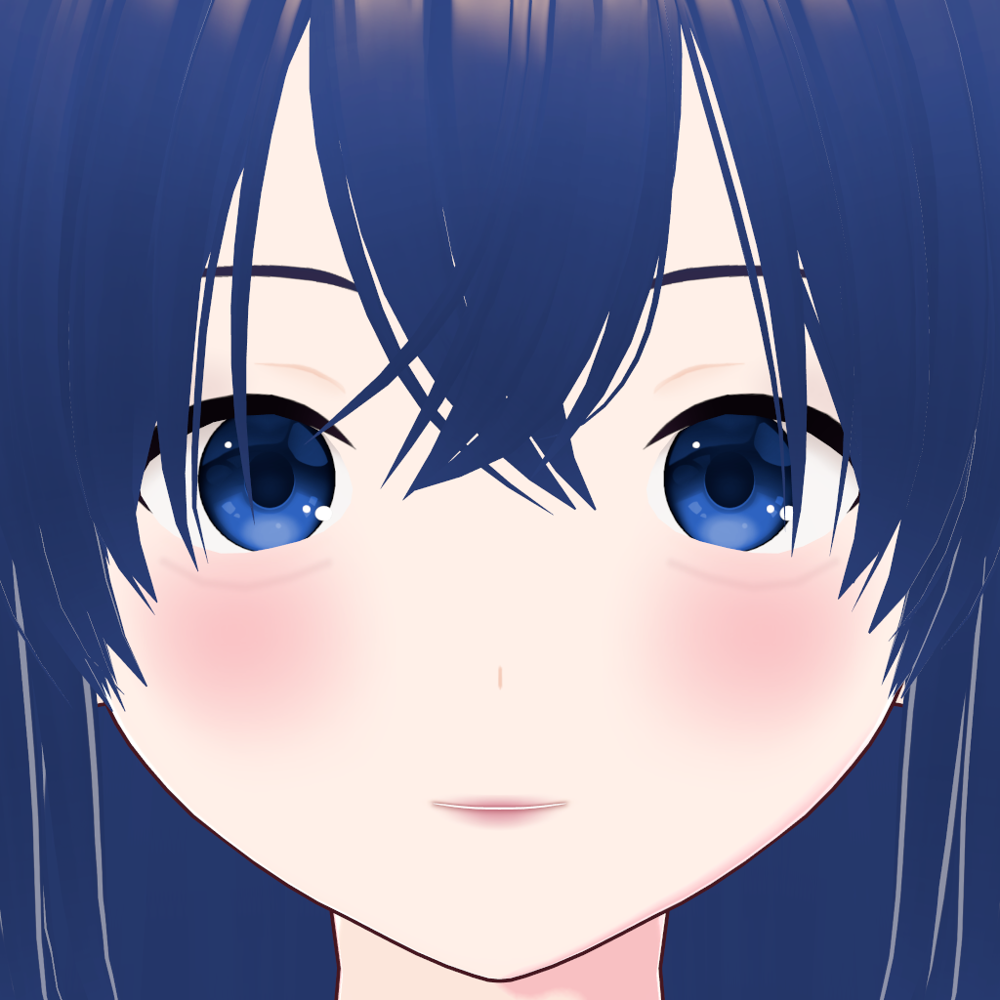
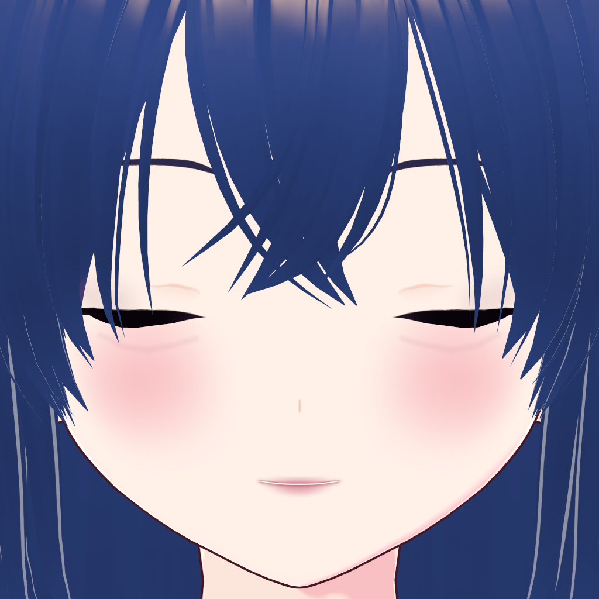
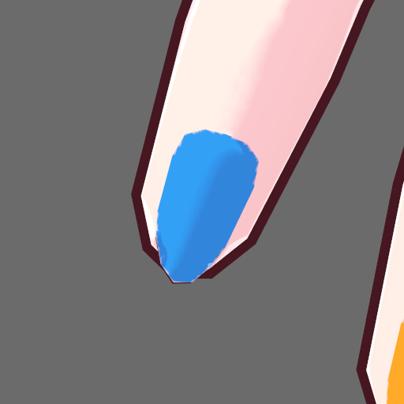
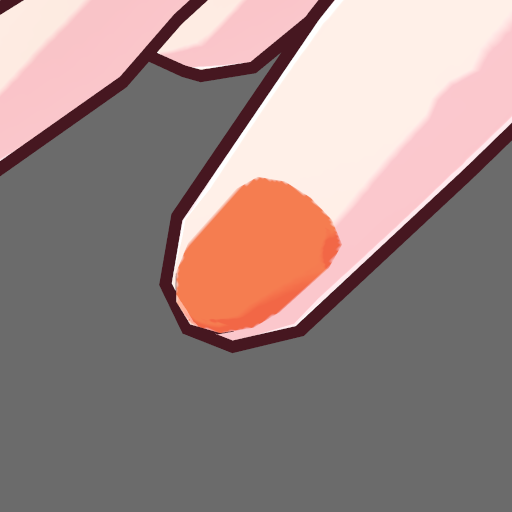

# VRoid Character MCP

**通过 MCP，让 AI 在 VRoid Studio 中调整角色、绘制局部妆容、编辑发束、装配服装并导出 VRM。**

[English](README.md) · **简体中文** · [繁體中文](README.zh-TW.md)

Windows · VRoid Studio 2.14.0 · 86 个 MCP 工具 · stdio · MIT

本项目通过 Frida 调用 VRoid Studio 的原生方法，不依赖鼠标自动化或 OCR。服务只启动一份具有独立配置的 VRoid 副本，不连接你已经打开的 VRoid 进程。

当前为 **0.4.1 开发版**。工具功能与角色美术分别验收：可以完成操作、保存重开和导出，不代表服装已经没有穿插，或已完成游戏引擎中的物理验证。

## 效果展示

以下为 **2026-10-19 开发验证中的原生截图**，不是 AI 生成的示意图。妆容、美甲和整套服装来自不同验证场景，尚未合并为最终角色。原图来源见 [截图说明](assets/showcase/README.md)。

### 服装装配与动作预览

| 整套装配 | 原生行走预览中的一帧 |
|:---:|:---:|
|  |  |

展示已导入的 `hem-align-v22` 服装候选及其动作预览。服装来自外部建模与绑定流程；本 MCP 负责导入、贴合参数、采集、保存和 VRM 导出。坐姿裙摆和部分穿插仍待处理。

### 眉毛与眼下妆容：绘制前后

| 绘制前 | 绘制后，保存并重新打开 |
|:---:|:---:|
|  |  |

保留原眉形，局部调整眉色，并在真实眼眶下方的皮肤区域添加阴影与高光。这是二维贴图绘制，不是新增眼袋几何。该示范已验证图层像素、Undo/Redo 与保存重开。

<details>
<summary>查看闭眼检查</summary>



闭眼仅用于临时采集，采集后恢复原状态，不会因此保存新的表情或动画。

</details>

### 手指美甲：实际甲面着色

| 左手食指 | 右手拇指 |
|:---:|:---:|
|  |  |

这组颜色用于验证十根**手指**的甲面定位与 RGB 贴图导入，不是脚趾美甲，也不是最终美甲款式。原生验证中，贴图变化限制在甲面遮罩内，并完成了保存重开检查。

## 能做什么

| 方向 | 当前能力 |
|---|---|
| 脸与身体 | 读取和调整五官、脸型、体型、身高等原生参数；修改后读回核对 |
| 发型与发束 | 应用已有预设，创建手绘发束组，读取和移动控制点，复制发束，调整形状与发骨参数，指派已有共享发材质 |
| 颜色 | 调整眼睛、皮肤、眉睫与全局发色；逐束可见发色仍有限制 |
| 贴图与图层 | 列出真实部位、渲染器和图层；打开对应画板；导出 PNG、UV 与表面数据；导入 PNG 为新图层；调整既有层显隐和透明度 |
| 局部妆容 | 在腮红、唇缘、眼皮、眉毛和眼下皮肤遮罩内预览并绘制软硬印章、连续笔触；保留原图层 |
| 美甲 | 根据手指骨骼与实际甲面生成十指 UV 遮罩，再进行局部贴图绘制与近景检查 |
| 换装 | 打开装配、导入 XWear、调整贴合参数、检查真实三维关系、保存 XRoid、导出 VRM 1.0 |
| 预览与检查 | 多角度截图、前后对照、表情与姿势预览、动作采样；提供受限的只读原生 API 内省 |

完整工具名称、参数、前置条件和错误处理见 [86 个工具参考](tools/TOOLS.md)。

## 环境要求

- Windows x64。
- VRoid Studio **2.14.0 / Unity 6000.0.62f1**。启动时校验 `GameAssembly.dll` 哈希，其他构建会被拒绝。
- Python **3.10 或更高版本**、Git、Node.js 与 npm。
- 一个支持本地 **stdio MCP** 的客户端，以及足够复制一份 VRoid 安装的磁盘空间。

仓库不包含 VRoid Studio 安装程序或角色模型。需要使用你自己的兼容安装。程序内的路径保护和副本隔离不等于操作系统沙箱。

## 快速开始

### 1. 获取项目并安装依赖

在 PowerShell 中执行。以下统一把仓库放在 `D:\VRoid-Character-MCP`，你可以换成其他目录。

```powershell
git clone https://github.com/froz3ncore/VRoid-Character-MCP.git D:\VRoid-Character-MCP
Set-Location D:\VRoid-Character-MCP

py -3.10 -m venv .venv
& .\.venv\Scripts\python.exe -m pip install -r requirements.txt
npm ci
```

如果使用更高版本的 Python，请把 `py -3.10` 换成相应解释器。`npm ci` 安装 Frida agent 使用的 `frida-il2cpp-bridge`。

### 2. 创建独立的 VRoid 副本

把 `--source` 改成实际安装目录，目录内应有 `VRoidStudio.exe` 和 `GameAssembly.dll`；`--lab` 必须是尚不存在的新目录，并且不能与源安装互相包含。

```powershell
& .\.venv\Scripts\python.exe .\prepare_lab.py `
  --source "C:\Program Files\VRoid Studio" `
  --lab "D:\VRoid-Character-Lab"
```

程序只读取源安装，复制并逐文件验证到副本的 `app/` 下，不覆盖已存在的副本。同一个副本同时只能由一个 MCP 服务占用；并行工作请分别准备副本。

### 3. 配置 MCP 客户端

以下是通用 stdio 配置；请按客户端要求填写，并确保三个路径与前面的实际目录一致。

```json
{
  "mcpServers": {
    "vroid": {
      "command": "D:\\VRoid-Character-MCP\\.venv\\Scripts\\python.exe",
      "args": [
        "D:\\VRoid-Character-MCP\\launch.py",
        "--lab",
        "D:\\VRoid-Character-Lab"
      ],
      "env": {
        "PYTHONUTF8": "1",
        "PYTHONIOENCODING": "utf-8"
      }
    }
  }
}
```

连接后应能发现 **86 个工具**。VRoid 副本在首次需要模型的调用时启动；首次初始化可能比后续调用慢。

## 推荐工作流

### 调整角色

1. 调用 `list_face_params`，取得当前 `model_token`，之后作为 `expected_model`。
2. 用 `list_parameters` 等读取当前可用参数，先采集基线图。
3. 分批调整，读回结果，并用 `capture_review` 检查正面、侧面和背面。
4. 用 `save_as` 在副本 `saves/` 下另存新的 `.vroid`。

重新打开模型或重启会话后，要重新取得 token。工具返回成功不能代替实际看图，也不会自动代表角色已经保存。

### 绘制妆容与美甲

1. 在普通编辑模式中列出部位与图层，确认要编辑的真实材质和画板。
2. 用 `open_texture_editor` 打开对应画板。需要保留导入 RGB 时，显式选择 `bake_colors=true`；它会把当前颜色烘焙进贴图，与之后的新笔触是不同操作。
3. 用 `export_makeup_region_mask` 或 `export_nail_uv_map` 获取当前模型的遮罩。
4. 面妆先 `preview_makeup_marks`，确认后再 `paint_makeup_marks`。美甲则依据导出的甲面遮罩准备透明 PNG，再用 `import_texture_layer` 导入为新图层；也可以用此方式导入已有妆容 PNG。
5. 检查实际渲染，再另存新文件，并重开核对。

`FaceSkin` 的眼下绘制必须明确指定 `area="under_eye"`；`MouthLine` 用于唇缘，`Mouth` 是口腔内部，不能当口红部位。遮罩与当前模型、参考层和几何绑定，更换模型、改脸型或重开后应重新获取。它不是原生三维自由画笔。

已有图层显隐与透明度通过 `set_texture_layer_state` 调整，需要新鲜的 `state_sha256`。妆容配方 CLI 见 `tools/replay_makeup_recipe.py --help`；它只接受匹配的底模与遮罩，不会自动适配不同脸型。

### 装配服装并导出

`get_wear_status` → `open_wear_project` → `import_xwear` → `set_wear_fit` → `save_wear_project` → `export_wear_vrm`。

换装使用自己的 wear token。普通模型 token 不能替代它；妆容工具也不能在装配已经打开时直接使用。导出前按工具要求停止并恢复默认预览，提供明确的标题、作者与新文件路径。

外部服装需先具备可用的网格、骨架和绑定。XWear 导入与 VRM 导出不会自动修复穿插、错误权重或布料物理。

## 验证与开发

```powershell
# 离线检查与源码清单，不启动 VRoid
powershell -NoProfile -ExecutionPolicy Bypass -File tools\run_checks.ps1 -Manifest

# 额外执行原生分域检查，会启动指定副本；该副本必须空闲
powershell -NoProfile -ExecutionPolicy Bypass -File tools\run_checks.ps1 `
  -Manifest -Native -Lab "D:\VRoid-Character-Lab"
```

检查输出 `checks.json` 与退出码，覆盖 Python 单元测试、工具 schema、JavaScript 语法和行为检查；`-Manifest` 增加源码清单检查。`-Provenance` 为继承实现替换的辅助检查，源码相似度数字本身不构成法律结论。

0.4.1 的既有验收记录为 **445 个 Python 测试通过、1 个跳过、5 组 JavaScript 行为检查通过**，并完成干净副本上的保存、重开、换装与 VRM 导出链路。该记录与限制见 [CHANGELOG.md](CHANGELOG.md) 和 [SCOPE.md](SCOPE.md)。

导出的文件可再用独立解析器检查：

```powershell
& .\.venv\Scripts\python.exe .\tools\vrm_inspect.py "D:\VRoid-Character-Lab\saves\avatar.vrm"
```

结构检查不代表完整 VRM 规范认证，也不代表外观、碰撞或游戏引擎物理验收。

## 已知限制

- **身高保存重开存在漂移**：当前构建在会话内达到目标后，重开仍可能高约 1.4 cm。
- **逐束可见发色尚未解决**：部分颜色元素虽能读回，但不驱动可见手绘发丝；目前可靠支持全局发色。
- **妆容与美甲定位有适用范围**：未知拓扑、共用 UV 或歧义部位会被拒绝，不能宣称任意模型都可自动识别。
- **M00 覆盖少于 F00**，不承诺同等效果。
- **后裙碰撞暂停且未解决**；截图里的服装仍是制作中候选。
- 原生批量编辑不是事务；发生部分成功或结果不确定时，先检查状态，不盲目重复写入。
- Godot 导入、MToon 最终外观、物理和游戏集成需要单独验证。

## 文档与许可

本项目非 pixiv／VRoid 官方产品。代码采用 [MIT](LICENSE)，重写说明与第三方来源见 [LICENSING.md](LICENSING.md)、[NOTICE](NOTICE)、[UPSTREAM.json](UPSTREAM.json) 和 [REWRITE.md](REWRITE.md)。示范截图不授予角色模型、服装素材或 VRoid Studio 的使用权，见 [截图说明](assets/showcase/README.md)。

- [工具参考](tools/TOOLS.md)：完整的 86 个工具与参数。
- [功能范围](SCOPE.md)：当前验收边界与未完成事项。
- [版本记录](CHANGELOG.md)：重构与验证情况。
- [重写记录](REWRITE.md)：替换过程与检查方法。
